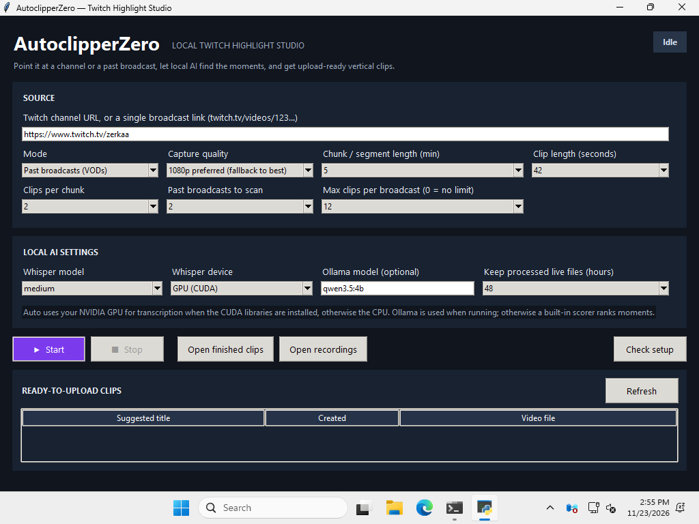

<div align="center">

# AutoClipper Zero

### Turn Twitch broadcasts into captioned vertical highlights — on your Windows PC.

A local-first Twitch highlight studio that captures VODs or live streams, transcribes speech, ranks candidate moments, and renders ready-to-review clips.

[](https://www.microsoft.com/windows)
[](https://www.python.org/)
[](https://github.com/SYSTRAN/faster-whisper)
[](https://ollama.com/)
[](LICENSE)

[**Open the project website**](https://sifat-jaman-13.github.io/autoclipper-zero/) · [**Installation**](#-installation) · [**Configuration**](#-configuration) · [**Troubleshooting**](#-troubleshooting)

</div>

---

## At a glance

- **Capture:** scan recent Twitch past broadcasts or record a channel while it is live.
- **Transcribe:** generate speech transcripts and word timestamps with faster-whisper.
- **Find moments:** rank candidate clips with optional local Ollama AI or the built-in heuristic scorer.
- **Render:** export vertical 9:16 MP4 clips with animated, word-highlighted captions.
- **Prepare:** create a matching text file with a suggested title, description, hashtags, transcript, score, and source timestamp.
- **Stay in control:** output stays on your PC; the app does not connect social accounts or publish videos.

<p align="center">
  
</p>

## How it works

```text
Twitch channel / VOD
        │
        ▼
Streamlink + yt-dlp + FFmpeg
        │
        ▼
Audio extraction and faster-whisper transcription
        │
        ▼
Candidate ranking: Ollama (optional) or local heuristic scorer
        │
        ▼
FFmpeg vertical crop + animated captions
        │
        ▼
MP4 clips + matching TXT upload notes
```

## Features

| Feature | What it does |
| --- | --- |
| Past broadcasts | Scans a channel's latest archived broadcasts, processes them in chunks, and remembers progress. |
| Single VOD | Paste a Twitch broadcast URL to process that broadcast without scanning the channel's VOD list. |
| Live capture | Records a live channel in segments and processes completed segments. |
| Speech transcription | Uses faster-whisper with selectable model sizes and automatic GPU-to-CPU fallback. |
| Highlight ranking | Sends candidate transcripts to a local Ollama model when available; otherwise uses transcript and audio-activity heuristics. |
| Vertical export | Creates 1080 × 1920, 30 FPS MP4 clips with AAC audio. |
| Animated captions | Burns word-timed karaoke-style captions into the video when usable word timestamps are available. |
| Upload notes | Saves a TXT sidecar with a suggested title, description, hashtags, source link or filename, timestamp range, score, reason, and transcript. |
| Resume support | Stores VOD/chunk progress and clip history locally so completed work can be skipped on later runs. |

> **Important:** Highlight selection is automated, not editorially guaranteed. The scorer uses speech transcripts and audio activity; it does not understand every visual event, game context, or Twitch chat. Review each result before publishing.

## 🧰 Installation

### Supported environment

| Requirement | Details |
| --- | --- |
| Operating system | Windows 10 or later |
| Python | 64-bit Python **3.11–3.15** |
| PowerShell | Windows PowerShell 5.1 or later |
| FFmpeg | Available on PATH; the build must include the `ass` subtitle filter (libass) |
| Internet | Required to retrieve Twitch streams/VODs and download Whisper models on first use |
| Optional GPU | NVIDIA GPU and compatible CUDA/cuDNN libraries for accelerated transcription |

The supplied setup script checks for a supported Python interpreter, creates a project-local virtual environment, installs the Python requirements, verifies imports, optionally installs NVIDIA CUDA libraries, and attempts to install FFmpeg Essentials with winget if FFmpeg is missing.

### 1. Get the project

Install [Git for Windows](https://git-scm.com/download/win) if you do not already have it. Open PowerShell and run:

```powershell
git clone https://github.com/sifat-jaman-13/autoclipper-zero.git
cd autoclipper-zero
```

Alternatively, use **Code → Download ZIP** on GitHub, extract the archive, and open PowerShell in the extracted project folder.

### 2. Install dependencies

Run the included setup script:

```powershell
Set-ExecutionPolicy -Scope Process Bypass
.\Setup.ps1
```

The execution-policy change applies only to the current PowerShell process. The script creates `.venv` and installs the packages listed in `requirements.txt`:

- `streamlink` — Twitch stream capture
- `yt-dlp` — VOD listing and metadata retrieval
- `faster-whisper` — speech transcription
- `numpy` — audio processing

The setup script also verifies the installed imports (including PyAV, a faster-whisper dependency). If winget is available and FFmpeg is missing, it offers to install the Gyan FFmpeg Essentials package.

**If you prefer to install dependencies manually**, first install a compatible 64-bit Python and FFmpeg with the required ASS/libass filter, then run:

```powershell
py -3.12 -m venv .venv
.\.venv\Scripts\Activate.ps1
python -m pip install --upgrade pip
python -m pip install -r requirements.txt
python -c "import numpy, av, faster_whisper, streamlink, yt_dlp; print('Dependencies OK')"
```

Use a Python version from 3.11 through 3.15. Replace `3.12` in the first command with the version installed on your computer. If the `py` launcher is unavailable, create the environment using the full path to your Python executable.

### 3. Start the application

After setup completes, open a **new** PowerShell window (especially if FFmpeg was just installed), return to the project directory, and run:

```powershell
.\Run-AutoclipperZero.ps1
```

The launcher checks the virtual environment, FFmpeg, and required Python imports before starting the desktop application.

### 4. First run

1. Enter a Twitch channel URL, such as `https://www.twitch.tv/zerkaa`, or a single VOD URL, such as `https://www.twitch.tv/videos/123456789`.
2. Choose **Past broadcasts** or **Live streams**.
3. Select the capture quality, segment length, clip duration, and number of clips.
4. Choose a Whisper model and transcription device.
5. Optionally configure Ollama as described below.
6. Press **Start** and watch the activity log for progress.
7. Use **Open finished clips** to review the generated MP4 files and their TXT sidecars.

The first transcription run downloads the selected Whisper model. Allow time and disk space for that download.

## 🤖 Optional local AI with Ollama

Ollama is optional. Without a reachable Ollama server, AutoClipper Zero uses its built-in heuristic scorer instead.

1. Install [Ollama for Windows](https://ollama.com/download/windows).
2. Open PowerShell and download the default model:

   ```powershell
   ollama pull qwen3.5:4b
   ```

3. Keep Ollama running and leave its local API at the default address: `http://127.0.0.1:11434`.
4. In AutoClipper Zero, enter the installed model name in **Ollama model**.

If you use a different model, pull it first and enter its exact local model name in the app. Ollama is used for candidate ranking and suggested titles/reasons; it does not replace Whisper transcription.

## ⚙️ Configuration

Most settings can be changed in the desktop app. They are saved to `config.json` when you start processing.

| Setting | Purpose | Default |
| --- | --- | --- |
| `channel_url` | Twitch channel URL or one VOD URL | `https://www.twitch.tv/zerkaa` |
| `source_mode` | `vods` or `live` | `vods` |
| `quality` | Preferred capture quality with fallback | `1080p60,1080p,best` |
| `segment_minutes` | Capture / processing chunk length | `5` |
| `clip_seconds` | Target highlight duration (app choices: 20–60 seconds) | `42` |
| `clips_per_segment` | Maximum selected clips per chunk (up to 5 internally) | `2` |
| `vod_count` | Number of recent archived broadcasts to scan | `2` |
| `max_clips_per_vod` | Per-broadcast clip cap; `0` means unlimited | `12` |
| `whisper_model` | `small`, `medium`, `large-v3-turbo`, or `large-v3` | `medium` |
| `whisper_device` | `auto`, `cpu`, or `cuda` | `auto` in the application defaults |
| `ollama_url` | Local Ollama API endpoint | `http://127.0.0.1:11434` |
| `ollama_model` | Local model used for ranking | `qwen3.5:4b` |
| `retention_hours` | Age threshold for cleanup of processed live recordings | `48` |
| `language` | Transcription language | `en` |

**Device selection:** `auto` tries CUDA and falls back to CPU if GPU transcription cannot start. `cpu` forces CPU transcription. `cuda` tries the GPU first and also falls back to CPU if unavailable.

**Performance tip:** Start with the `small` Whisper model and CPU mode if you are troubleshooting memory or CUDA issues. Larger models generally need more memory and processing time.

## 📁 Output and local data

All generated working data is stored in `AutoclipperZeroData\`:

| Path | Contents |
| --- | --- |
| `ready_to_upload\` | Finished MP4 clips and matching TXT notes |
| `recordings\` | Temporary live-stream segments |
| `temp\` | Temporary audio and subtitle files |
| `state.json` | VOD/chunk progress and clip history |

The application also saves settings in the project-root `config.json`. The `.gitignore` excludes generated working data and the virtual environment from Git.

For a single VOD URL, the app processes that broadcast and then stops. For a channel URL in Past broadcasts mode, it scans the configured number of recent VODs, skips completed broadcasts, and checks for new ones every 30 minutes. Live mode records and processes finished segments; processed live recordings are eligible for cleanup after the configured retention period.

## 🛠️ Troubleshooting

| Problem | What to try |
| --- | --- |
| `python` or a compatible interpreter is not detected | Install 64-bit Python 3.11–3.15, then rerun `Setup.ps1`. |
| PowerShell says scripts are disabled | Run `Set-ExecutionPolicy -Scope Process Bypass` in the same PowerShell window, then run the setup script again. |
| FFmpeg is not found | Install a Windows FFmpeg build that includes the ASS/libass subtitle filter, add its `bin` directory to PATH, then close and reopen PowerShell. |
| Missing `av` or `ctranslate2` import | Re-run `Setup.ps1`. If using a very new Python release, try Python 3.12 or 3.13 as the setup script itself suggests. |
| CUDA or cuDNN errors | Set **Whisper device** to **CPU only**. GPU transcription is optional. |
| Ollama is not detected | Start Ollama, verify the model name, or continue with the built-in scorer. |
| A VOD cannot be retrieved | Check that the broadcast is still available and accessible to your account/network. Deleted, private, subscriber-restricted, or otherwise inaccessible streams may not be downloadable. |
| No clips are produced | Check the activity log. Segments with no usable speech or no candidate above the selection threshold are skipped. |
| Captions are missing | Confirm FFmpeg includes the `ass` filter and that the source contains speech with word timestamps. |

The app includes a **Check setup** button that reports Python, FFmpeg, Streamlink, yt-dlp, faster-whisper, PyAV, NumPy, CUDA-library, and Ollama detection status.

## 🔐 Privacy, permissions, and responsible use

- Processing and generated files are kept on your computer; the app does not log in to social platforms or upload clips for you.
- Twitch content is retrieved over the network using Streamlink and yt-dlp. The selected Whisper model is downloaded on first use.
- If Ollama is enabled, candidate transcript text is sent to the Ollama endpoint configured in the app. The default endpoint is a local address.
- Only download, process, and publish streams or clips you have permission to use. Respect Twitch's terms, broadcasters' rules, music and game-content rights, and the policies of any platform where you share clips.
- Review every clip and its metadata before publishing. Automated scoring can miss context or select an unsuitable moment.

## 🗂️ Project structure

```text
autoclipper-zero/
├── autoclipperzero.py       # Tkinter desktop app and processing engine
├── config.json              # Saved application settings
├── requirements.txt         # Python package dependencies
├── Setup.ps1                # Environment and dependency setup
├── Run-AutoclipperZero.ps1  # Application launcher
├── docs/
│   ├── index.html           # GitHub Pages project website
│   └── assets/              # Website screenshots and assets
└── LICENSE                  # Proprietary non-commercial licence
```

## 🧑‍💻 Development and CI

The repository includes a Windows GitHub Actions workflow that installs Python 3.12, FFmpeg, application dependencies, and screenshot-only GUI dependencies, launches the desktop app, and captures its real window for the documentation. A separate workflow deploys the `docs/` directory to GitHub Pages.

To run the app locally while developing, use the same setup and launch commands above. The screenshot workflow's extra packages (`pyautogui`, `pygetwindow`, and `pillow`) are only needed for automated screenshot capture; they are not listed as runtime application dependencies.

## 🙌 Credits

Created by **Sifat Jaman**.

## 📄 Licence

AutoClipper Zero is distributed under a **proprietary, source-available, non-commercial licence**. It is **not an open-source licence**.

- Personal and individual educational use is permitted under the licence terms.
- Business, organisational, monetised, and other commercial use requires prior written permission from the applicable copyright holder(s).
- Public redistribution of the software, modified or unmodified, is not permitted without separate prior written permission.
- Third-party components and materials remain subject to their own licences.

Read [LICENSE](LICENSE) before using, modifying, or distributing this project.

---

<div align="center">

**Found a bug or have an improvement?** Open an issue or submit a contribution for review.

[Back to top ↑](#autoclipper-zero)

</div>
